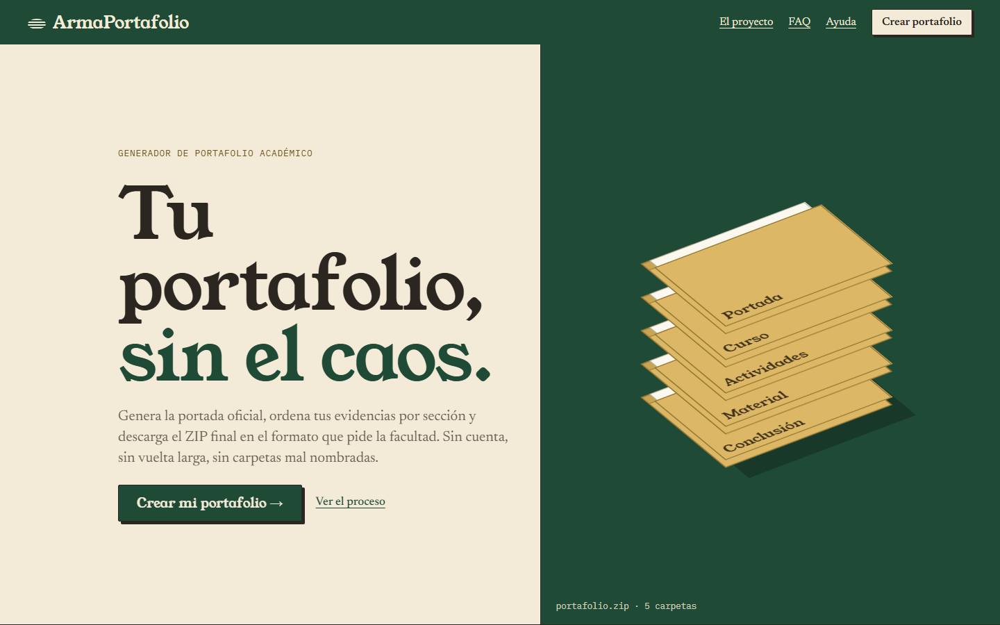
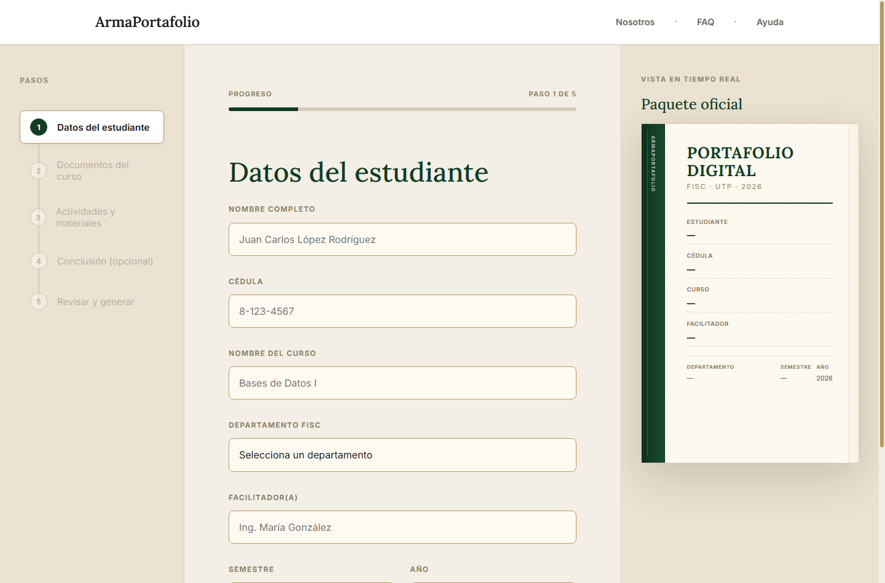
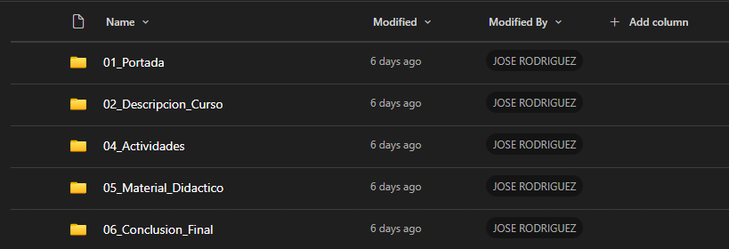

# ArmaPortafolio

[English](README.md) · **Español**

ArmaPortafolio es una herramienta estática que funciona en el navegador para armar portafolios académicos. Ayuda al estudiante a ingresar los datos de la portada, añadir las evidencias del curso, ordenar los archivos en la estructura de carpetas que pide la facultad y descargar un ZIP final.

La aplicación procesa los datos del portafolio en el navegador. No tiene backend propio, subida de archivos a un servidor, sistema de cuentas ni base de datos. El ZIP generado puede guardarse de forma temporal en IndexedDB para que la página de descarga lo encuentre; si ese paso no está disponible, la aplicación lo descarga directamente.

Demo en vivo: [armaport.pages.dev](https://armaport.pages.dev)

> Nota de alcance: este repositorio es una exportación estática pública, no una plataforma operativa. No implementa colaboración, validación en servidor, monitoreo en tiempo real, mensajería, verificación de campo ni funciones de IA.

## Capturas



Página de inicio con el acceso al generador y el portafolio representado como una pila de carpetas.



Pantalla del generador con el flujo de cinco pasos, el formulario de datos del estudiante, la pila de carpetas que se llena al añadir evidencias y la vista previa de la portada.


`Portada.pdf` generada, tal como queda incluida en el paquete final.



Ejemplo de la estructura de carpetas dentro del ZIP descargado.

El generador funciona de forma local en el navegador, sin cuenta y sin subir archivos a un servidor. Tiene límites técnicos prácticos (10 MB por archivo y 160 MB por paquete), que se describen más abajo.

## Flujo principal

1. Recoge los datos del estudiante, el curso, el departamento, el facilitador, el semestre y el año.
2. Acepta evidencias opcionales, agrupadas en las categorías del portafolio.
3. Genera la portada `Portada.pdf` en el navegador con la plantilla y las fuentes incluidas.
4. Añade la portada, los archivos subidos y la conclusión opcional a un ZIP estructurado.
5. Guarda el último ZIP de forma temporal en IndexedDB, abre la pantalla de descarga y borra la copia guardada después de descargarla.

## Implementación técnica

- HTML, CSS y JavaScript sin frameworks ni paso de compilación. El `package.json` del repositorio solo contiene las herramientas de revisión y pruebas.
- `pdf-lib` crea el documento PDF e incrusta la imagen de la portada y las fuentes.
- `fontkit` se registra en `pdf-lib` para poder incrustar las fuentes Liberation Sans en el PDF generado.
- `js/zip.js` contiene un escritor de ZIP propio, sin compresión. Escribe las cabeceras locales, las entradas del directorio central, el registro de fin de directorio central y las sumas CRC-32. El proyecto no usa JSZip.
- IndexedDB guarda únicamente el Blob del último ZIP generado, su nombre y su fecha de creación, para entregarlo a `descarga.html`.
- El movimiento es CSS más un script pequeño (`js/landing.js`). No se carga ninguna biblioteca de animación.

## Manejo de archivos y límites

El flujo de subida aplica listas de formatos permitidos y límites por categoría:

- Tamaño máximo por archivo: 10 MB.
- Tamaño máximo del paquete: 160 MB.
- Los límites por categoría van de 1 a 120 archivos, según la sección.
- Se aceptan documentos, hojas de cálculo, presentaciones, código fuente, imágenes y archivos comprimidos.
- Se rechazan las extensiones ejecutables o de script peligrosas.
- Los nombres de archivo y las rutas relativas se limpian antes de entrar al ZIP. Se eliminan los segmentos de salto de directorio, se normalizan los nombres y las rutas repetidas reciben sufijos como `_2`.
- Los campos obligatorios del estudiante y la longitud de los textos se validan antes de generar.

## Estructura del repositorio

```text
.
|-- .github/      Flujo de integración y publicación
|-- assets/       Plantilla de la portada, fuentes y capturas de muestra
|-- css/          Estilos de la aplicación
|-- docs/         Avisos legales y de terceros
|-- js/           Generador, validación, ZIP, descarga e inicio
|-- screenshots/  Capturas públicas del README
|-- scripts/      Revisión estática, servidor local y exportación pública
|-- tests/        Pruebas en navegador
|-- vendor/       Copias de pdf-lib y fontkit
|-- *.html        Páginas estáticas de la aplicación
|-- _headers      Cabeceras de respuesta de Cloudflare Pages
|-- _redirects    Redirecciones de Cloudflare Pages
|-- robots.txt
|-- sitemap.xml
`-- LICENSE
```

## Desarrollo local

El sitio no tiene dependencias ni paso de compilación. El repositorio incluye un conjunto pequeño de herramientas en Node (versión 22 o superior) para revisarlo, probarlo y publicarlo.

```powershell
npm install
npx playwright install chromium
```

| Comando | Qué hace |
|---|---|
| `npm run serve` | Sirve la carpeta en `http://127.0.0.1:4173` con las cabeceras de `_headers`, incluida la Content-Security-Policy. |
| `npm run check` | Revisión estática: archivos y enlaces que no existen, código en línea que la CSP bloquearía, orígenes externos que la CSP no permite, ids repetidos o inexistentes y sintaxis de JavaScript. |
| `npm run test:e2e` | Arma `dist/`, la sirve con las cabeceras de producción y corre las pruebas en navegador: cada página carga sin errores de consola ni desborde horizontal, validación, rechazo de archivos y un recorrido completo que genera un ZIP y revisa su estructura de carpetas. |
| `npm test` | `check` y luego las pruebas en navegador. |
| `npm run build` | Escribe la exportación pública en `dist/`. |

Para probar a mano, usa `npm run serve` en lugar de un servidor estático cualquiera. Un servidor simple no envía la Content-Security-Policy, así que no muestra lo que producción bloquea. Abrir los archivos HTML con `file://` tampoco es un entorno representativo.

## Integración continua y publicación

`.github/workflows/ci.yml` corre en cada pull request y en cada push a `main`:

1. **Revisar y probar**: `npm run check` y luego las pruebas en navegador contra `dist/`, servida con las cabeceras de producción.
2. **Publicar en Cloudflare Pages**: solo en `main` y solo si el paso 1 pasó. Arma `dist/` y la sube al proyecto `armaport` de Pages.

El proyecto de Pages es de subida directa, así que Cloudflare no construye desde este repositorio por su cuenta; la subida la hace el flujo. Necesita dos secretos en el repositorio:

- `CLOUDFLARE_API_TOKEN`: un token de API con el permiso *Account / Cloudflare Pages / Edit*.
- `CLOUDFLARE_ACCOUNT_ID`: el identificador de cuenta que muestra el panel de Cloudflare.

Sin ellos, el trabajo de publicación termina con un aviso y no sube nada. El trabajo corre en el entorno `production`; si se le agrega un revisor obligatorio, cada publicación pasa a requerir aprobación manual.

Para publicar a mano:

```powershell
npm run build
npx wrangler@4 pages deploy dist --project-name armaport
```

`dist/` contiene solo los archivos públicos: las páginas HTML, `css/`, `js/`, `assets/`, `vendor/`, `_headers`, `_redirects`, `robots.txt`, `sitemap.xml`, `favicon.svg` y `LICENSE`.

## Documentación

- [Avisos de terceros](docs/THIRD_PARTY_NOTICES.md)
- [Avisos sobre los recursos](docs/ASSET_NOTICES.md)
- [Licencia en español](LICENSE.es.md)
